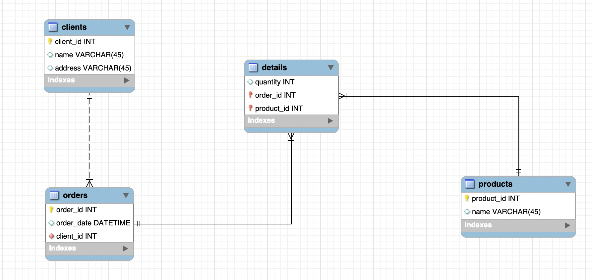
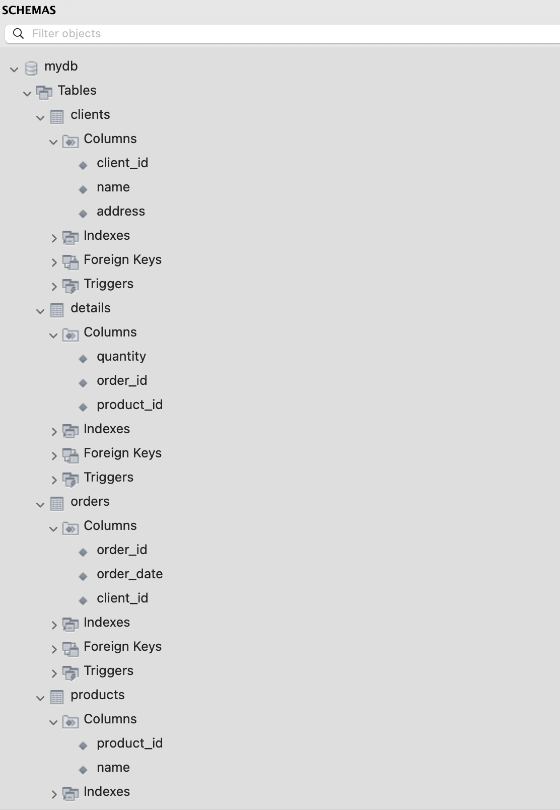

# Нормалізація бази даних

### 1НФ (Перша нормальна форма)

| Номер_замовлення | Товар | Кількість | Адреса_клієнта | Дата_замовлення | Клієнт |
| :--- | :--- | :--- | :--- | :--- | :--- |
| 101 | Лептоп | 3 | Хрещатик 1 | 2023-03-15 | Мельник |
| 101 | Мишка | 2 | Хрещатик 1 | 2023-03-15 | Мельник |
| 102 | Принтер | 1 | Басейна 2 | 2023-03-16 | Шевченко |
| 103 | Мишка | 4 | Комп'ютерна 3 | 2023-03-17 | Коваленко |

### 2НФ (Друга нормальна форма)
Виносимо в окрему таблицю те, що стосується безпосередньо замовлення, щоб позбутися часткової залежності від складеного ключа (Номер_замовлення + Товар).

**Таблиця "Замовлення"**

| Номер_замовлення | Дата_замовлення | Клієнт | Адреса_клієнта |
| :--- | :--- | :--- | :--- |
| 101 | 2023-03-15 | Мельник | Хрещатик 1 |
| 102 | 2023-03-16 | Шевченко | Басейна 2 |
| 103 | 2023-03-17 | Коваленко | Комп'ютерна 3 |

**Таблиця "Деталі_замовлення"**

| Номер_замовлення | Товар | Кількість |
| :--- | :--- | :--- |
| 101 | Лептоп | 3 |
| 101 | Мишка | 2 |
| 102 | Принтер | 1 |
| 103 | Мишка | 4 |

### 3НФ (Третя нормальна форма)
Прибираємо транзитивні залежності. Адреса залежить від клієнта, а не від замовлення. Товари виносимо в окремий довідник, щоб не писати назви текстом. Додаємо всім сутностям унікальні ID.

**Таблиця "Клієнти"**

| client_id | name | address |
| :--- | :--- | :--- |
| 1 | Мельник | Хрещатик 1 |
| 2 | Шевченко | Басейна 2 |
| 3 | Коваленко | Комп'ютерна 3 |

**Таблиця "Товари"**

| product_id | name |
| :--- | :--- |
| 1 | Лептоп |
| 2 | Мишка |
| 3 | Принтер |

**Таблиця "Замовлення"**

| order_id | order_date | client_id |
| :--- | :--- | :--- |
| 101 | 2023-03-15 | 1 |
| 102 | 2023-03-16 | 2 |
| 103 | 2023-03-17 | 3 |

**Таблиця "Деталі_замовлення"**

| order_id | product_id | quantity |
| :--- | :--- | :--- |
| 101 | 1 | 3 |
| 101 | 2 | 2 |
| 102 | 3 | 1 |
| 103 | 2 | 4 |

### ER-діаграма отриманих таблиць

### Таблиці в базі даних

